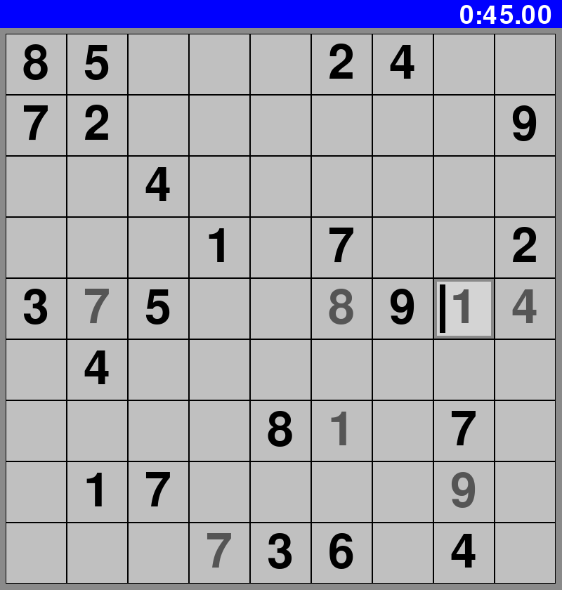
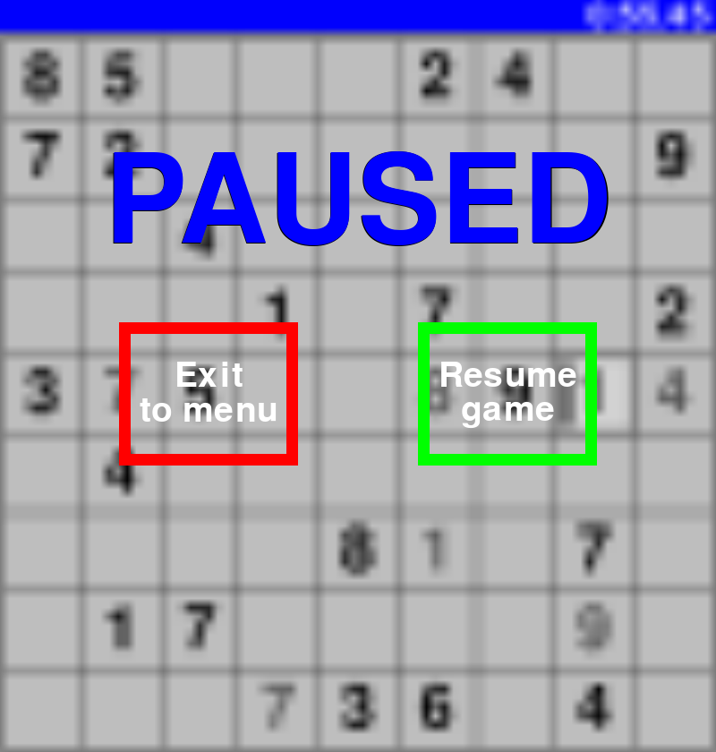

# Sudoku player and solver

Play and solve Sudoku! Solver written in pure python. Game powered by [Pygame](https://www.pygame.org/docs/). 

## Running the game

With Python 3.9 or newer, run the following commands from the project directory:

```sh
pip install .
python sd-gui.py
```

## How to play

Click or use the arrow keys to select an empty square and use the number keys at the top of the keyboard to enter a digit from 1 to 9. 

To win: fill each row, column, and 3×3 box with the digits 1 through 9 exactly once.

| Control | Action |
| --- | --- |
| Arrow keys | Move to the next editable square in that direction (skips clues) |
| Backspace | Clear the selected square |
| Left-click | Select square |
| Right-click | Erase entry in square under the pointer |
| Esc | Pause/Unpause |

| Seven moves into the puzzle | The same game after pressing Esc |
| --- | --- |
|  |  |

## Using the solver

From a Python session in the repository directory, using the solver on the same puzzle used by the player:

```python
from sudoku import board6b, greedyBestDepthFirst, print_board

solution = greedyBestDepthFirst(board6b)
print_board(solution)
```

To supply your own board, pass a 9x9 2d array of strings to the method above. Use digits `"1"` through `"9"` for clues and `"."` for empty squares.

The game uses `greedyBestDepthFirst` in [sudoku.py](sudoku.py) to find the solution at startup. It fills any square with only one possible digit. When that stops yielding moves, it picks a square with the fewest candidates and tries each choice depth-first. It abandons a branch as soon as an empty square has no candidates left.
